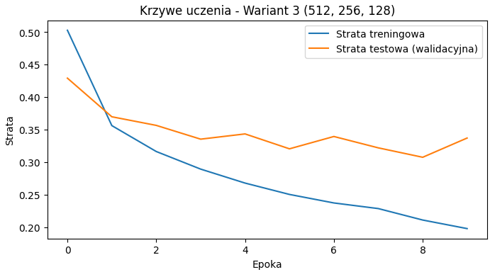
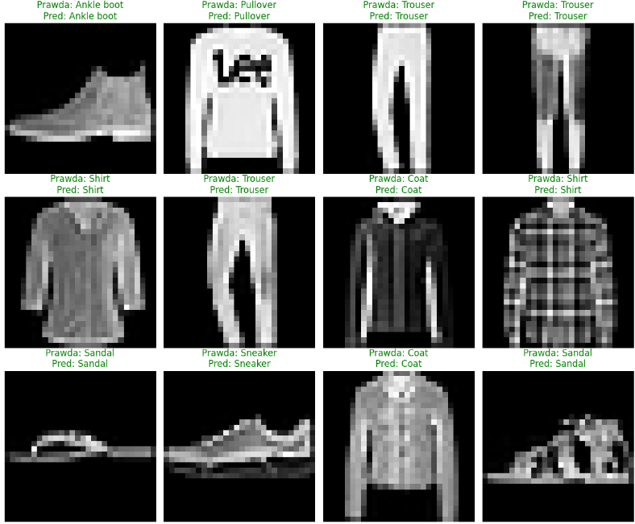

# Szablon sprawozdania laboratoryjnego

**Przedmiot:** Uczenie głębokie do rozpoznawania obiektów
**Zajęcia nr / temat:** 01 Obraz jako dane; pierwszy klasyfikator obrazów(MLP)
**Autor / grupa:**  Mateusz Pluta GL 5.03
**Data:** 14.10.2026r.

## 1. Cel ćwiczenia

**Krótki opis celu i zakresu zadania**
Wytrenowanie perceptronu wielowarstwowego(MLP) do rozpoznawania kategorii obrazów
na zbiorze FashionMNIST. 
**Uzasadnienie wyboru FashionMNIST**
Obrazy w tym zbiorze mają tylko skale szarości i rozmiar 28x28 pikseli.

## 2. Metoda i implementacja

**Wykorzystane narzędzia, modele i zbiory danych.**
PyTorch, torchvision, matplotlib, MLP i FashionMNIST

**Najważniejsze fragmenty kodu (lub link do repozytorium/notatnika).**

https://github.com/mattty1/Uczenie-glebokie-do-rozpoznawania-obiektow.git

**Konfiguracja (architektura, hiperparametry, augmentacje).**
3 warianty warstw ukrytych: (128), (256, 128), (512, 256, 128).
Funkcja aktywacji: ReLU,
Optymalizator: Adam,
Liczba epok: 10,
Rozmiar paczki 128
## 3. Wyniki

**Metryki (np. accuracy, precision/recall, mAP, IoU).**
Wariant (128): 101 770 parametrów, Accuracy = 0.8788.
Wariant (256, 128): 235 146 parametrów, Accuracy = 0.8781.   
Wariant (512, 256, 128): 567 434 parametrów, Accuracy = 0.8834.   
**Wykresy / przykładowe predykcje (bounding boxy, mapy cech).**

## 4. Analiza i interpretacja

Najczęściej mylone są klasy o podobnym kształcie i konturach, np. koszula (Shirt) z koszulką (T-shirt/top) lub swetrem (Pullover). Wynika to z ograniczeń architektury MLP: funkcja flatten spłaszcza obraz do jednowymiarowego wektora, przez co sieć traci informacje o relacjach przestrzennych (2D) między sąsiadującymi pikselami.

## 5. Wnioski

Pomyślnie wytrenowano modele MLP, jednak zauważalne są ich wady przy analizie obrazu. Głównym kierunkiem poprawy byłoby zastąpienie warstw gęstych sieciami splotowymi (CNN), które natywnie wspierają analizę lokalnych wzorców na obrazie.

---

## Kryteria oceny (rubryka)

| Element | Waga |
|---|---|
| Poprawność implementacji | 40% |
| Wyniki i ich interpretacja | 30% |
| Czytelność kodu (PEP8, komentarze) | 20% |
| Wnioski | 10% |

Próg zaliczenia sprawozdań (O1): 90%. Oddanie: do tygodnia po zajęciach.
