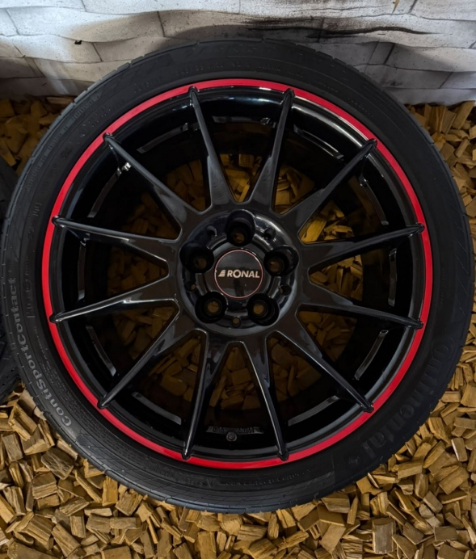
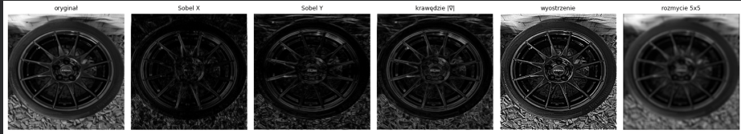
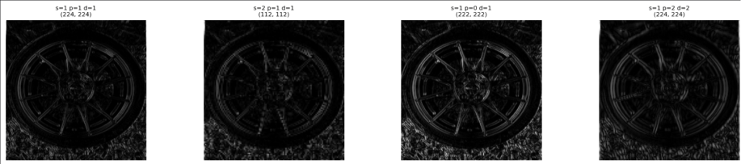
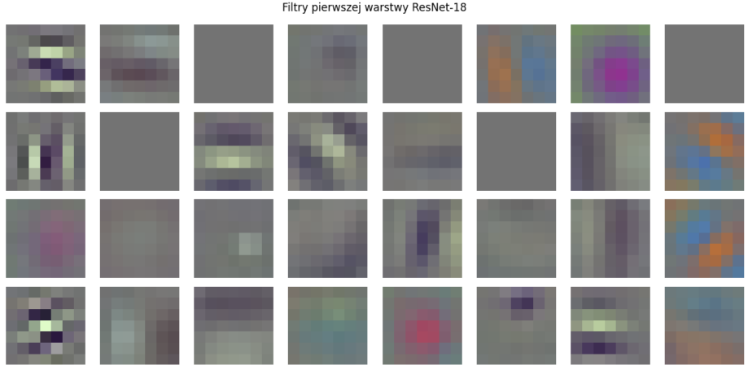
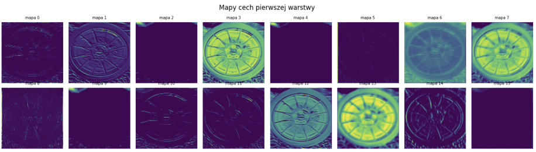
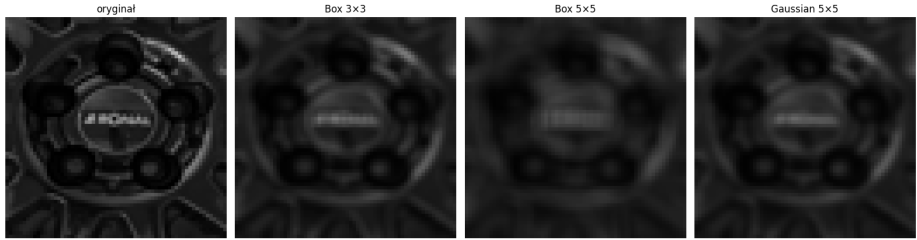

# Szablon sprawozdania laboratoryjnego

**Przedmiot:** Uczenie głębokie do rozpoznawania obiektów
**Zajęcia nr / temat:** 5 / Warstwy splotowe
**Autor / grupa:** Mateusz Pluta / GL5.03
**Data:** 13.11.2026r.

## 1. Cel ćwiczenia

Celem ćwiczenia było sprawdzenie, jak działa warstwa splotowa na własnym zdjęciu w skali szarości. Zastosowałem ręczne jądra przez `F.conv2d`, sprawdziłem wzór na wymiary wyjścia, zobaczyłem wpływ `stride`, `padding` i `dilation`, obejrzałem mapy cech pretrenowanego ResNet-18 i porównałem filtry rozmywające Box 3×3, Box 5×5 oraz Gaussian 5×5.

## 2. Metoda i implementacja

Pythona z PyTorch, torchvision (pretrenowany `resnet18`) i matplotlib. Jedno własne zdjęcie, zamienione na skalę szarości i przeskalowane do 224×224. Do ResNet-18 przekazałem tę samą szarość w trzech kanałach.

Zdjęcie:

Konfiguracja:
- jądra ręczne: Sobel X, Sobel Y, Sharpen i rozmycie Box 5×5, wszystkie ze `stride=1`, `dilation=1` i `padding=k//2`,
- magnituda krawędzi: `sqrt(gx² + gy²)`,
- rozmycia do porównania: Box 3×3 (wagi 1/9), Box 5×5 (wagi 1/25), Gaussian 5×5 (`[1,4,6,4,1]` razy samo na siebie, podzielone przez 256), padding 1, 2 i 2,
- sieć: ResNet-18 z wagami `DEFAULT`, mapy z `conv1` po ReLU.

Link do repozytorium: https://github.com/mattty1/Uczenie-glebokie-do-rozpoznawania-obiektow.git

## 3. Wyniki

**Ręczne jądra**

| Jądro | Co robi |
|---|---|
| Sobel X | wykrywa krawędzie pionowe (zmiana jasności wzdłuż osi X) |
| Sobel Y | wykrywa krawędzie poziome (zmiana jasności wzdłuż osi Y) |
| Magnituda | pokazuje siłę krawędzi niezależnie od kierunku |
| Sharpen | wyostrza obraz, zwiększa kontrast przy krawędziach |
| Box 5×5 | rozmywa obraz, uśrednia piksele z okna 5×5 |

**Wzór na wymiary wyjścia**

Dla wejścia 32×32 policzyłem wymiar ze wzoru `out = ⌊(in + 2p − d(k−1) − 1)/s⌋ + 1` i porównałem z `nn.Conv2d`:

| k | s | p | d | wzór | `nn.Conv2d` |
|---|---|---|---|------|-------------|
| 3 | 1 | 1 | 1 | 32 | 32 |
| 3 | 2 | 1 | 1 | 16 | 16 |
| 5 | 1 | 2 | 1 | 32 | 32 |
| 3 | 1 | 2 | 2 | 32 | 32 |
| 7 | 2 | 3 | 1 | 16 | 16 |

Wszystkie wyniki się zgadzają.

**Wpływ stride, padding i dilation**

| stride | padding | dilation | rozmiar wyjścia |
|---|---|---|---|
| 1 | 1 | 1 | 224×224 |
| 2 | 1 | 1 | 112×112 |
| 1 | 0 | 1 | 222×222 |
| 1 | 2 | 2 | 224×224 |

**Mapy cech ResNet-18**

Pierwsza warstwa `conv1` ma 64 filtry 7×7×3. Dla wejścia 224×224 daje mapy 112×112.

**Porównanie filtrów rozmywających**

Wybrany fragment zdjęcia (64×64 px) z krawędzią i drobnym detalem, przed filtracją i po Box 3×3, Box 5×5 i Gaussian 5×5, na wspólnej skali jasności:

Wagi wszystkich trzech filtrów sumują się do 1. W Boxie 5×5 każda waga to 0,04, a w Gaussianie 5×5 środek ma ok. 0,14, a rogi ok. 0,004.

## 4. Analiza i interpretacja

**Jądra ręczne.** Sobel X mocno reaguje na krawędzie pionowe, a Sobel Y na poziome. Dopiero magnituda pokazuje wszystkie krawędzie naraz. Sobel ma sumę wag 0, więc w jednolitych miejscach daje zero. Sharpen i rozmycie mają sumę 1, więc nie zmieniają średniej jasności.

**Parametry.** Wzór zgadza się z `nn.Conv2d` w każdym przypadku. `stride=2` zmniejsza mapę prawie dwa razy, a `padding=0` ucina po 1 pikselu z każdej strony. Przy `dilation=2` jądro 3×3 patrzy na obszar 5×5, więc żeby zachować rozmiar, trzeba dać `padding=2`.

**Mapy cech.** Filtry z pierwszej warstwy wyglądają jak detektory krawędzi o różnych kierunkach oraz plamy koloru i proste tekstury. Część map pokazuje głównie kontury obiektów, a inne jasne lub teksturowane obszary. Ponieważ zdjęcie jest szare, filtry reagujące na różnice kolorów dają słabsze odpowiedzi.

**Rozmycia.** Box 5×5 rozmywa mocniej niż Box 3×3: krawędzie są bardziej rozmyte, a drobne detale (cienkie linie, tekstura) prawie znikają, podczas gdy po Boxie 3×3 jeszcze je widać. Gaussian 5×5 ma to samo okno co Box 5×5, ale większe wagi przy środku, więc piksele bliżej środka liczą się bardziej. Przez to wynik jest gładszy i naturalniejszy, a krawędzie są trochę lepiej zachowane niż w Boxie, który traktuje wszystkie piksele z okna tak samo.

**Ograniczenia.** Wnioski dotyczą jednego zdjęcia i jednego fragmentu. Domyślny padding zerami może dawać artefakty na brzegach obrazu.

## 5. Wnioski

- Wagi jądra decydują o tym, co filtr robi: jądra o sumie 0 wykrywają krawędzie, a o sumie 1 rozmywają lub wyostrzają.
- Wzór na wymiary wyjścia działa i zgadza się z `nn.Conv2d`. Rozmiar zostaje taki sam przy `s=1` i `2p = d(k−1)`.
- `stride` zmniejsza mapę, `padding` pilnuje brzegów, a `dilation` zwiększa zasięg okna bez nowych wag.
- Pierwsza warstwa ResNet-18 uczy się filtrów podobnych do ręcznych detektorów krawędzi.
- Box 5×5 rozmywa mocniej niż Box 3×3, a Gaussian 5×5 jest łagodniejszy niż Box 5×5 dzięki malejącym wagom. Można by jeszcze sprawdzić `padding_mode="replicate"` albo inne zdjęcia.

---

## Kryteria oceny (rubryka)

| Element | Waga |
|---|---|
| Poprawność implementacji | 40% |
| Wyniki i ich interpretacja | 30% |
| Czytelność kodu (PEP8, komentarze) | 20% |
| Wnioski | 10% |

Próg zaliczenia sprawozdań (O1): 90%. Oddanie: do tygodnia po zajęciach.
